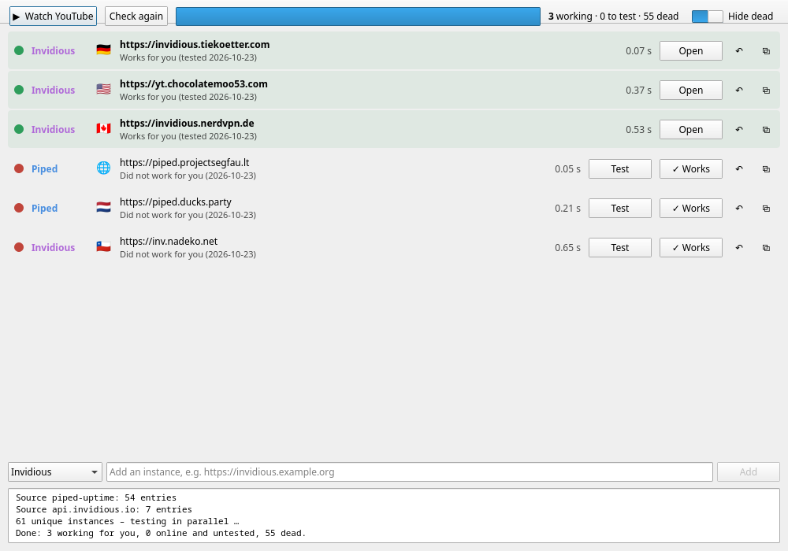
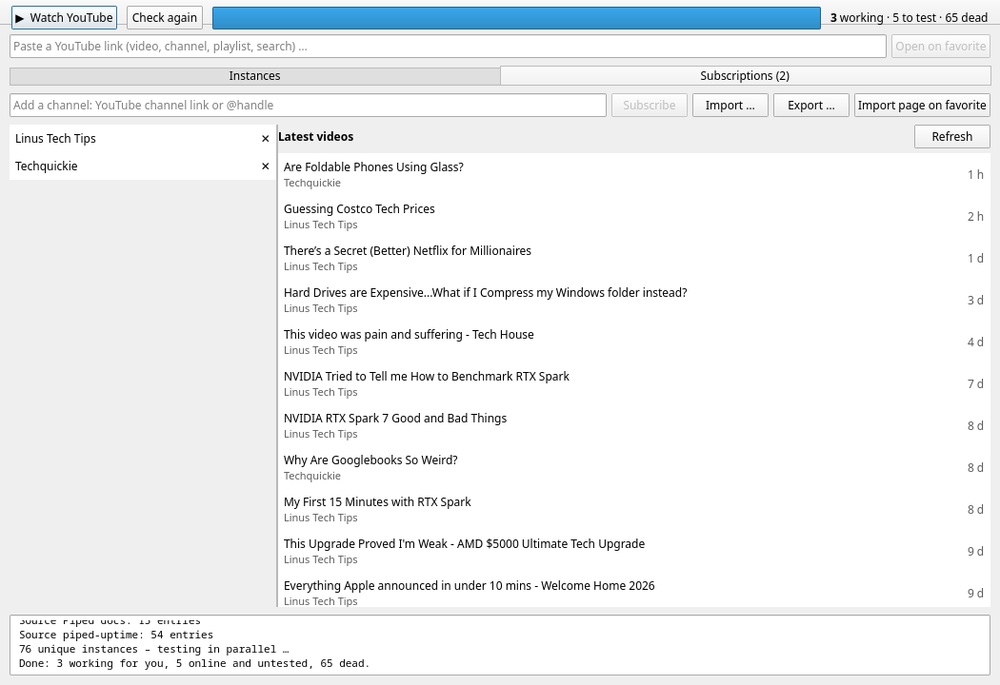

# Invidious & Piped Checker

Finds public Invidious, Piped, Poke, CloudTube and Hyperpipe instances that are actually alive, lets you test them in your own browser, remembers the ones that work for you, and keeps your subscriptions independent of any instance.



## Why

Most public instances listed online are dead, have their API disabled, or are blocked by YouTube. Many of the remaining sites sit behind bot checks (captchas) that keep automated players out, so a script can't reliably tell whether a video will play. This tool automates everything up to that point and leaves the final playback test to you.

## Features

**Instances**
- Collects instances from [api.invidious.io](https://api.invidious.io), the [Piped docs](https://github.com/TeamPiped/documentation/blob/main/content/docs/public-instances/index.md), [piped-uptime](https://github.com/TeamPiped/piped-uptime), [LibRedirect](https://github.com/libredirect/instances) and [Farside](https://github.com/benbusby/farside), and merges duplicates.
- Tests each one in parallel:
  - **API** (Invidious and Piped): fetches a real video, runs a search, and checks that the stream delivers bytes, which is what apps like Yattee, FreeTube or NewPipe need.
  - **Website**: checks whether the site responds. Bot-check pages count as online.
- **Test** opens a short video in your default browser, and **Works** or **Broken** saves your verdict.
- Keeps a history of every check and ranks instances by uptime over the last 30 days. Until there is enough history, it falls back to the uptime from api.invidious.io.
- **Watch YouTube** opens your most reliable working favorite.
- Paste any YouTube link (video, short, channel, playlist, search) to open the same page there.

**Subscriptions**
- Stored locally, so they survive when an instance dies. No account needed.
- Import from YouTube Takeout (CSV), Invidious (JSON), NewPipe, FreeTube or OPML. Add single channels by link or `@handle`.
- The feed of latest videos comes from YouTube's public RSS feeds, and clicking a video opens it on your favorite instance.
- Export as Invidious JSON or OPML. **Import page on favorite** opens the Invidious import page to restore an account.



The bot checks are not bypassed. Playback has to be confirmed by you. Fetching the feed and resolving `@handles` contacts youtube.com directly, without an account.

## Download

Grab the AppImage from the [latest release](https://github.com/fromaaage/invidious-piped-checker/releases/latest). It contains everything, so there is nothing to install:

```sh
chmod +x Invidious_Piped_Checker-*-x86_64.AppImage
./Invidious_Piped_Checker-*-x86_64.AppImage
```

Linux x86_64 only. If it complains about FUSE, start it with `--appimage-extract-and-run`.

## Run from source

- Python ≥ 3.10
- PySide6 (Qt 6) and requests

```sh
# Arch
sudo pacman -S pyside6 python-requests
# others
pip install PySide6 requests
```

```sh
python app.py                 # GUI, starts checking right away
python app.py --no-autoscan   # GUI without the automatic check
python core.py                # CLI table
python core.py --json         # CLI, JSON output
```

To build the AppImage yourself: `packaging/build-appimage.sh [version]`. Releases are built automatically by GitHub Actions when a `v*` tag is pushed.

Your marks, check history, subscriptions and custom instances are stored in `~/.config/invidious-piped-checker/`.
